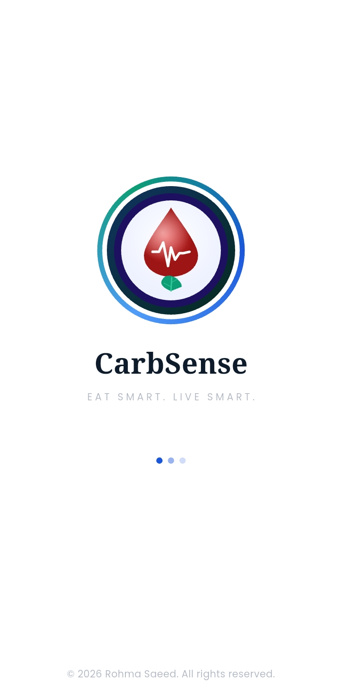
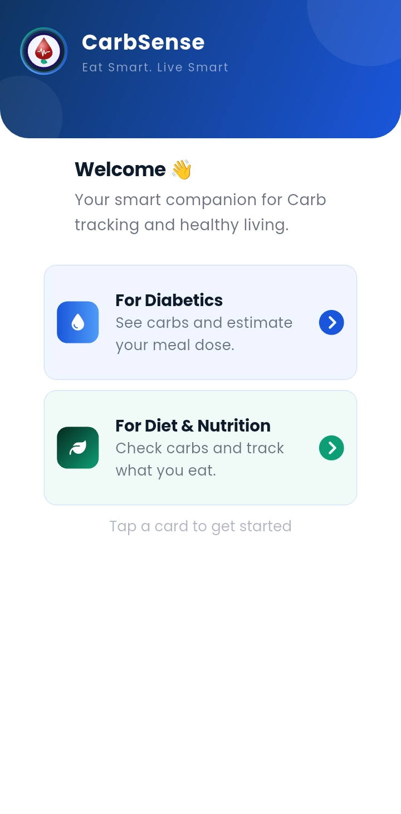
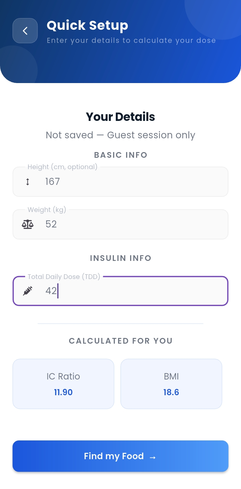
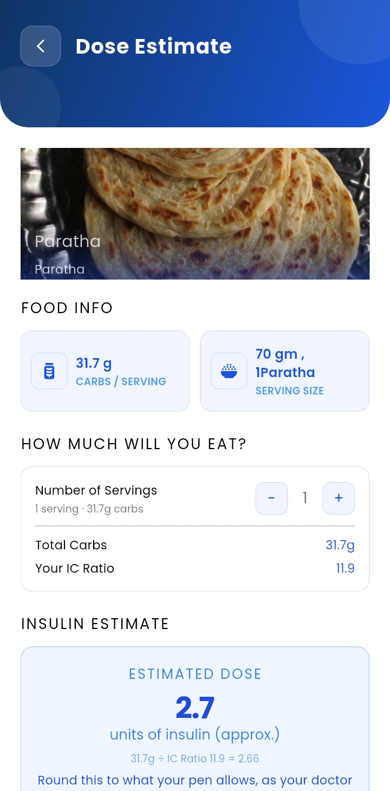

# 🩺 CarbSense

**A Flutter app that helps people with Type 1 diabetes estimate the insulin they need for an extra meal or snack.**

People with Type 1 diabetes already follow a daily insulin plan from their doctor. The hard part is when they eat something *extra*, like a snack, a dessert or an unplanned meal. To estimate the extra insulin, they need to know how many carbohydrates that food contains. CarbSense lets them pick a common Pakistani food, choose how much they'll eat, and see the carbs and an approximate insulin dose in seconds.

It also has a **Diet mode** for anyone who simply wants to keep an eye on their carbs.

> **Status:** Beta. The Android APK is being tested by Type 1 diabetic users.

---

## 📱 Screenshots

| Splash | Home | Quick Setup | Dose Estimate |
|:---:|:---:|:---:|:---:|
|  |  |  |  |

---

## ✨ Features

### Diabetic mode
- **Quick setup:** enter your Total Daily Dose (TDD), and the app works out your IC Ratio (500 ÷ TDD)
- **Food database:** 85 common foods in 9 categories (cereals, fruits, desserts, Asian food, fast food and more), with serving sizes and carbs per serving
- **Search** by food name or description
- **Servings stepper:** carbs update as you change the amount
- **Dose estimate:** carbs ÷ IC Ratio, shown to one decimal place with the formula visible, so users can see exactly how it was calculated
- **Safety checks:**
  - TDD outside a realistic range is rejected, which catches typos like 420 instead of 42
  - Asks the user to double-check when their TDD looks unusual for their body weight
  - Doses below 1 unit get a "check with your doctor" message instead of a number
  - A clear reminder that the doctor's advice always comes first

### Diet mode
- Pick a goal (lose weight, maintain, build muscle, low carb)
- Every food is labelled **Low / Medium / High** carb
- Optional daily carb target with a progress bar
- **"Eaten today" list** that adds up your carbs as you go

### Guest mode
- Works without an account. Nothing is saved, and no internet is needed for the food data.

---

## 🛠️ Built with

- **Flutter & Dart**
- **Provider** for state management (the "eaten today" log)
- **csv** to load the food database from a local file
- **google_fonts** (Poppins) and **font_awesome_flutter**
- Shared screens use a mode setting (`AppUserMode`) to switch between diabetic and diet mode, which avoids duplicate code

### Project structure
```
lib/
├── core/constants/   # colors, text styles, app mode
├── models/           # FoodItem
├── services/         # loads the food CSV
├── providers/        # DietLogProvider (eaten-today log)
├── Views/            # app screens
├── widgets/          # reusable widgets (app bar, cards, text box)
└── utils/            # routes, carb level rules
assets/data/carbsense_foods.csv   # the food database
```

---

## 🚀 Run it yourself

```bash
git clone https://github.com/Rohma-creates/carbsense.git
cd carbsense
flutter pub get
flutter run
```

---

## 🗺️ Roadmap

- [ ] User accounts with Firebase, so settings and logs are saved
- [ ] More foods, plus barcode lookup with the Open Food Facts API
- [ ] Protein and fat information
- [ ] iOS build
- [ ] Doctor review of the dose formula and safety limits

---

## ⚠️ Disclaimer

CarbSense is **not a medical device**, and its estimates are for guidance only. The actual insulin dose can depend on blood sugar, activity, illness and other factors. Always follow your doctor's instructions.

---

## 🐞 Feedback welcome

I'm a self-taught Flutter developer, and I'd really value other eyes on my work. If you try the app or read the code and spot a bug, a bad practice or something that could be better, please [open an issue](https://github.com/Rohma-creates/carbsense/issues). Honest code reviews are very welcome.

---

## 👩‍💻 Author

**Rohma Saeed**, Flutter Developer and Computer Engineer
[GitHub](https://github.com/Rohma-creates) · [LinkedIn](https://www.linkedin.com/in/rohma-saeed)
